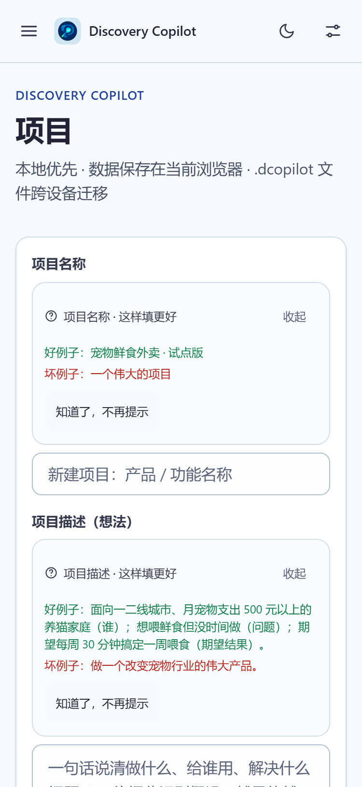
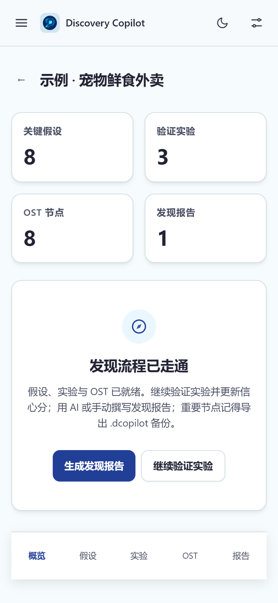
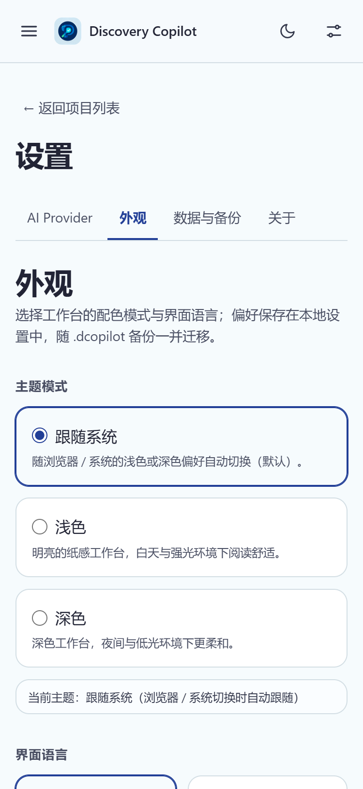
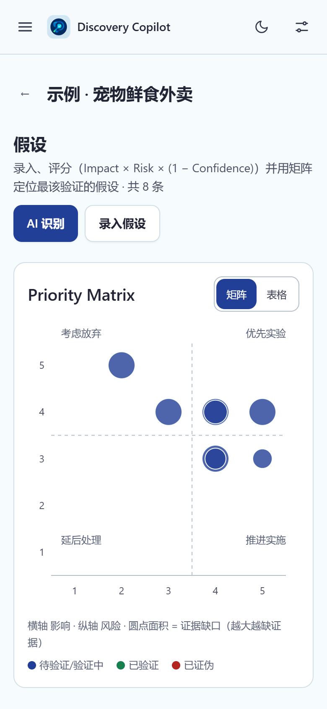

<div align="center">

# Discovery Copilot (Web)

**Local-first. Your data stays yours.**

An account-free, local-first (IndexedDB), BYOK product discovery workspace that migrates across devices via `.dcopilot` files.

[](./package.json)
[](LICENSE)
[](https://nodejs.org/)
[](https://pnpm.io/)

[Live demo](https://discovery-copilot-web.pages.dev) · [Quick start](#quick-start) · [Features](#features) · [Security model](#security-model) · [Issues](https://github.com/MRMU29/discovery-copilot-web/issues)

</div>

English | [简体中文](./README.md)

Not affiliated with Microsoft Discovery or GitHub Copilot. This is a local-first product discovery workbench.

**Turn assumptions, experiments and reports into one complete discovery flow — the data never leaves your browser.**

Live: <https://discovery-copilot-web.pages.dev>

## Contents

| Getting started | Capabilities | Development & reference |
| :--- | :--- | :--- |
| [Quick start](#quick-start)<br />[Mobile](#mobile)<br />[Development](#development) | [Features](#features)<br />[Tech stack](#tech-stack)<br />[Security model](#security-model) | [Deployment](#deployment)<br />[Tests](#tests)<br />[Privacy & data retention](#privacy--data-retention)<br />[License & credits](#license--credits) |

## Quick start

Open <https://discovery-copilot-web.pages.dev> (or build it yourself per Development below). No sign-up.

1. **Skip or follow the tour** — the first-run guide explains the main areas.
2. **Load the sample project** — click "Load sample project" on the home page, or create a project from scratch.
3. **Write assumptions, see priority** — record assumptions across eight risk categories; priority is computed as Impact × Risk × (1 − Confidence). Switch the matrix to its equivalent table view when needed.
4. **Plan experiments, draw the OST** — generate experiments from an assumption, review and save them; connect opportunities, solutions and experiments in the opportunity solution tree with drag & drop, keyboard equivalents and a table view.
5. **Produce a report** — write it by hand or draft it with AI; AI-generated and user-confirmed content are clearly distinguished. Prefer HTML export for sharing.
6. **Back up** — export `.dcopilot` from Settings → Data backup. It is the only cross-device migration path; an overwrite import creates a local snapshot first.

To use AI, add a provider and enter your own API Key under Settings → AI Provider. **The Key lives in session memory only and is gone when the page closes** — re-enter it after a refresh or restart. You can also skip AI entirely and use Prompt Relay (copy & paste prompts manually). Mobile browsers work too; the layout collapses to a single column.

## Features

| What you want to do | What the workspace provides |
| --- | --- |
| Manage projects | Create / edit / delete (30-day recycle bin) / one-click sample project |
| Work through key assumptions | Eight risk categories, Impact × Risk × (1 − Confidence) prioritization, Recharts priority matrix (with an equivalent table view) |
| Plan experiments | Generate from assumptions → review → save → status & result write-back |
| Draw an opportunity solution tree (OST) | Drag & drop + pinch zoom + keyboard equivalents + table view + viewport culling |
| Use AI assistance | Three modes: BYOK direct calls (OpenAI-compatible / Gemini), Prompt Relay (zero-setup copy & paste), and Hybrid; identify / experiment / report tasks; review-first workflow (preview / apply / reject / regenerate / cancel) |
| Keep AI costs in check | Pre-request token & cost estimates, budget circuit breakers (per-request + monthly), daily usage view; models with unknown pricing are neither estimated nor gated |
| Produce discovery reports | AI-generated or hand-written, AI vs. user-confirmed content distinguished; HTML (faithful, recommended) / PNG (best-effort) export |
| Back up and migrate | `.dcopilot` export (all / single project), import (six-scenario validation, conflict strategies, rollback on failure), automatic pre-overwrite snapshots (3 kept) |
| Tune appearance & language | Light / dark / follow-system themes (no first-frame flash), launch-screen animation, 8 interface languages (zh-Hans / zh-Hant / en / ja / ko / ru / de / fr, migrating with `.dcopilot`) |
| Protect privacy & observability | Data stays local, de-identified diagnostics export |

## Mobile

On narrow screens (375 / 390 / 768) the layout collapses to a single column: drawer navigation, >=44px touch targets, bottom safe area, scrollable modals; the priority matrix and OST canvas get table/card equivalents with no horizontal overflow. Screenshots below were captured at 375 / 390 px widths:

| Dashboard | Project overview |
| :---: | :---: |
|  |  |

| Settings | Assumptions / OST |
| :---: | :---: |
|  |  |

## Tech stack

React 18 + TypeScript + Vite · Tailwind CSS 4 (single-source design tokens in `src/styles/tokens.css`) · Dexie + IndexedDB · React Router · dnd-kit · Recharts · Zod · marked + DOMPurify · html-to-image · Vitest + fake-indexeddb

## Development

```bash
pnpm install
pnpm dev              # dev server (add --host to test from a phone)
pnpm build            # type check + production build
pnpm test             # full Vitest suite (includes a 20 MB import stress probe)
pnpm test:coverage    # coverage gate (schemas/db/ai lines >= 80%)
pnpm lint && pnpm typecheck
pnpm preview          # preview the production build locally
pnpm probe:provider-cors   # provider direct-call CORS matrix (no key needed)
```

- Token preview: `/dev/tokens`; PNG fidelity probe: `/dev/export-probe` (dev mode only)

## Deployment

The build output is fully static (`pnpm build` → `dist/`) and works on any static host. This repository deploys to **Cloudflare Pages** (connected to GitHub; every push to `main` auto-builds):

1. Cloudflare dashboard → Workers & Pages → Create → Pages → connect `MRMU29/discovery-copilot-web`
2. Build command `pnpm build`, output directory `dist`
3. Recommended env vars: `NODE_VERSION=24`, `PNPM_VERSION=12.6` (the Cloudflare build image may ship older defaults)
4. `public/_redirects` (SPA deep-link fallback) and `public/_headers` (CSP and other security headers) take effect automatically with each build

<details>
<summary>Self-hosting (nginx example)</summary>

```nginx
location / {
  try_files $uri $uri/ /index.html;   # SPA fallback
  add_header Content-Security-Policy "default-src 'self'; script-src 'self'; style-src 'self' 'unsafe-inline'; img-src 'self' data: blob:; font-src 'self' data:; connect-src *; base-uri 'self'; form-action 'self'; frame-ancestors 'none'" always;
  add_header X-Content-Type-Options "nosniff" always;
  add_header Referrer-Policy "strict-origin-when-cross-origin" always;
}
```

</details>

### A note on CSP

`script-src 'self'` is the injection defense; `connect-src *` is **intentionally open** — BYOK users configure their own AI provider base URLs (any domain), which the app cannot know in advance. The app itself loads no third-party scripts.

## Security model

- **The API Key lives in session memory only** (gone when the page closes): never written to IndexedDB or localStorage, never exported with `.dcopilot`, never placed in URLs, logs or diagnostics; there is no "remember key" feature. A Key entered while adding a Provider is also session-only. Re-enter the key after importing a backup on a new device.
- Backup files (`.dcopilot`) and diagnostics contain no secrets; diagnostics hold only de-identified metadata (versions, browser environment, storage overview, last 50 AI request metadata records, and the hostnames of your configured AI providers — domain only, no path or key) with a full preview before export.
- AI output (including report Markdown) is sanitized with DOMPurify both for in-app rendering and exported files (protocol allow-list, XSS defense).
- The app ships a full Privacy Policy and Terms of Use (with a disclaimer) in-app under Settings → About → Product & documents.

## Privacy & data retention

- Project data lives only in your current browser (IndexedDB); clearing site data or uninstalling the browser = unrecoverable loss, so export backups first.
- When you call AI, the relevant input is sent to the AI service **you configured** and handled under its privacy policy; in Prompt Relay mode the content is handed to the external AI by you and never passes through any server of this app.
- No account, no telemetry, no server, no tracking cookies; static pages are served by the hosting platform.
- Settings → About → Reset app deletes all local data and returns the storage space.
- The API Key lives in session memory only and is gone when the page closes; it is never written to IndexedDB / localStorage, nor exported with `.dcopilot` or diagnostics. Exports use a strict allow-list; `settings` structurally rejects secret-shaped fields.
- Settings → Data backup → Clear project data also deletes local snapshots (a snapshot holds a full `.dcopilot` payload, so keeping it would allow a one-click restore); "Clear all session Keys" only clears in-memory keys and keeps provider configs.

## Pre-release security checks

Run before releasing or contributing:

```bash
pnpm security:check
```

Manual pre-release checklist:

```bash
git status --short                                        # worktree clean, no untracked sensitive files
git ls-files | grep -Ei '\.env|\.pem|\.key|\.dcopilot'   # should print nothing
pnpm security:check                                       # the four checks below + keyword scan
```

The script (`scripts/security-check.mjs`) fails on any of four checks:

1. `git status --porcelain`: untracked files must not match sensitive paths (`.env*`, `*.pem`, `*.key`, …)
2. `git ls-files`: tracked files must not contain sensitive paths
3. All text sources must not match real credential shapes (length-gated patterns for OpenAI/GitHub/AWS/Google/Anthropic keys, PEM private key headers, and assignment-style `apiKey` / `secret` / `token` keywords)
4. The release repository must not include internal workspace docs (AGENTS/HANDOFF/acceptance records, etc.)

A second gate runs before local release builds: `scripts/prepare-release.mjs` rebuilds the release tree and aborts if it contains any internal material, user data, or credential shapes.

On the GitHub side: `.github/dependabot.yml` (weekly npm / GitHub Actions checks) is configured in this repo. **Secret Scanning, Push Protection and Dependabot alerts are repository settings that the public API cannot read (admin-only); verify them under GitHub → Settings → Code security** — this README makes no claim about their state. `.env.example` documents naming conventions only — the app needs no environment variables at runtime.

## Browser support baseline

- **P0**: Windows Chrome / Edge (latest two major versions); Android Chrome (latest)
- **Best effort**: Safari 16+, iOS Safari 16+, Firefox (latest two major versions)
- **Known differences**: tighter storage quota on iOS Safari, background tabs may interrupt long transactions, higher memory peaks on large imports

## Known limitations

1. Score audit trail (score_events) does not migrate with `.dcopilot` (no key in the §7.2 format); current assumption scores migrate fully.
2. PNG report export is best-effort (html-to-image may drift on complex gradients/custom fonts) — **use HTML export for faithful sharing**.
3. Session-memory API keys mean re-entry after every refresh / browser restart. "Save for this session" in Settings only keeps the key in the current page's memory for AI dialogs; it does not survive a refresh.
4. Capacity limits (§5.4): <= 50 local projects, <= 200 assumptions / 300 OST nodes / 100 experiments / 20 reports per project; imports <= 20 MB per file.
5. BYOK direct calls depend on each provider's CORS policy — use a compatible proxy for providers that block browsers (`pnpm probe:provider-cors` probes without a key).
6. No auto-sync: **local data is the only copy** — export `.dcopilot` backups regularly (deleted projects are restorable from the recycle bin for 30 days).
7. No Service Worker / offline manifest: the first visit needs a network connection to load static assets; offline use later depends on the browser cache and is not guaranteed.
8. Models with unknown pricing are neither cost-estimated nor budget-gated by design; the gate applies only to models with known pricing.

## Tests

Unit + integration tests (Vitest, fake-indexeddb covering IndexedDB transactions and migrations; see `pnpm test` for the current count); dedicated tests for all six import scenarios (valid / invalid / corrupted / legacy / conflict / rollback); coverage gate at schemas/db/ai lines >= 80%.

## License & credits

This project is [MIT](./LICENSE) licensed, Copyright (c) 2026 MRMU29.

**Credits**

- Upstream projects used via npm dependencies under their respective licenses (see `package.json`): React, Vite, Tailwind CSS, Dexie, React Router, dnd-kit, Recharts, Zod, marked, DOMPurify, html-to-image, Vitest and others.

---

<div align="center">

[Report an issue](https://github.com/MRMU29/discovery-copilot-web/issues) · [Source](https://github.com/MRMU29/discovery-copilot-web) · [Live demo](https://discovery-copilot-web.pages.dev)

<sub>Discovery Copilot · Local-first. Your data stays yours.</sub>

</div>
