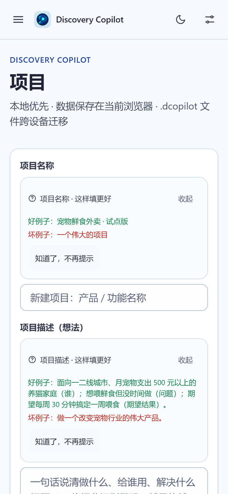
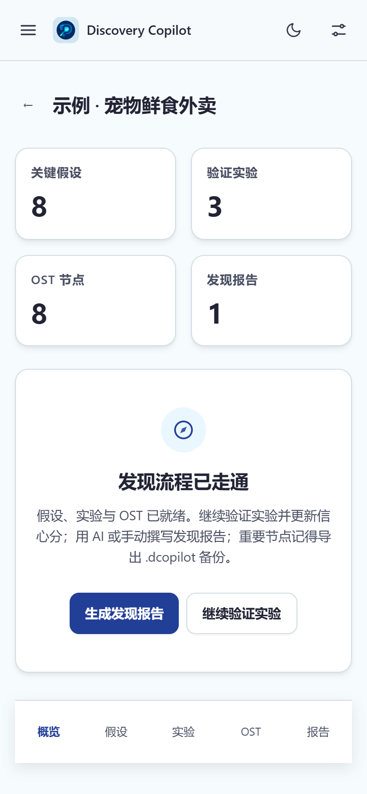
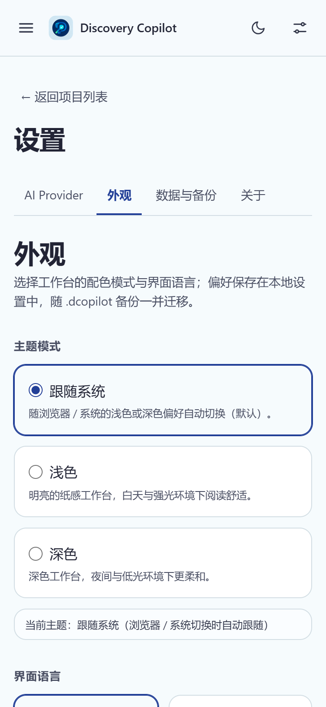
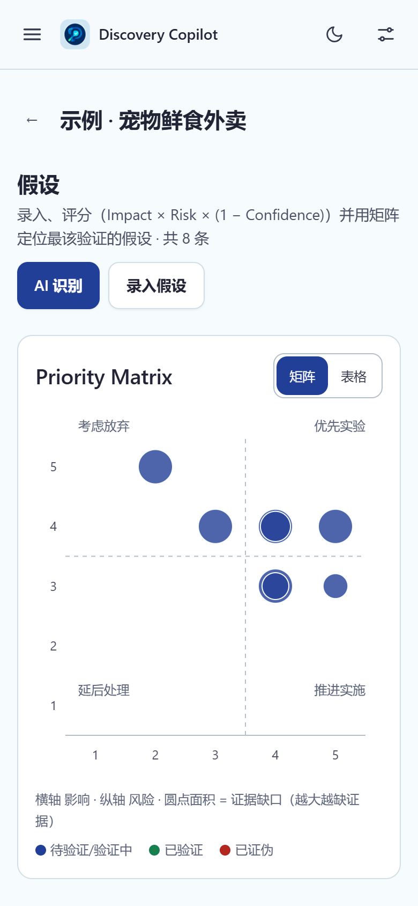

<div align="center">

# Discovery Copilot (Web)

**本地优先，数据自己掌握。**

无需账号 · IndexedDB 本地存储 · BYOK · `.dcopilot` 文件跨设备迁移的产品发现工作台

[](./package.json)
[](LICENSE)
[](https://nodejs.org/)
[](https://pnpm.io/)

[在线体验](https://discovery-copilot-web.pages.dev) · [快速上手](#快速上手) · [功能一览](#功能一览) · [安全模型](#安全模型) · [问题反馈](https://github.com/MRMU29/discovery-copilot-web/issues)

</div>

[English](./README.en.md) | 简体中文

与 Microsoft Discovery、GitHub Copilot 无任何关联；本项目是本地优先的产品发现工作台。

**把假设、实验与报告串成一条完整的产品发现流程；数据只留在你自己的浏览器里。**

线上地址：<https://discovery-copilot-web.pages.dev>

## 目录

| 开始使用 | 能力 | 开发与参考 |
| :--- | :--- | :--- |
| [快速上手](#快速上手)<br />[手机端](#手机端)<br />[开发](#开发) | [功能一览](#功能一览)<br />[技术栈](#技术栈)<br />[安全模型](#安全模型) | [部署](#部署)<br />[测试](#测试)<br />[隐私与数据留存](#隐私与数据留存)<br />[许可证与致谢](#许可证与致谢) |

## 快速上手

打开 <https://discovery-copilot-web.pages.dev>（或按后面的「开发」自行构建），无需注册。

1. **跳过或跟随引导** —— 首次进入会说明工作区的几个关键区域。
2. **加载示例项目** —— 首页点「加载示例项目」，或直接新建项目，先有一个可操作的对象。
3. **写假设、看优先级** —— 在「假设」页按八类风险记录，优先级由 Impact × Risk × (1 − Confidence) 自动算出；矩阵看不清可切换表格等价视图。
4. **规划实验、画 OST** —— 从假设生成实验并审核保存；在「机会解决方案树」里把机会、方案、实验连起来，支持拖拽、键盘等价操作与表格视图。
5. **生成报告** —— 手动撰写或让 AI 起草，AI 生成与用户确认的内容会明确区分；分享优先用 HTML 导出。
6. **备份** —— 「设置 → 数据备份」导出 `.dcopilot`，这是唯一的跨设备迁移方式；覆盖式导入前会自动生成本地快照。

要用 AI 功能，先在「设置 → AI Provider」添加服务商并填写自己的 API Key。**Key 只保存在当前会话内存，关闭页面即消失**，刷新或重开需重新输入；也可以完全不用 AI，走 Prompt Relay 手动复制粘贴提示词。手机浏览器同样可用，界面会自动折叠为单栏。

## 功能一览

| 你想完成的工作 | 工作台提供的能力 |
| --- | --- |
| 管理产品项目 | 创建 / 编辑 / 删除（回收站保留 30 天）/ 示例项目一键加载 |
| 梳理关键假设 | 八类风险假设、Impact × Risk × (1 − Confidence) 优先级、Recharts 优先级矩阵（含表格等价视图） |
| 规划实验 | 从假设生成 → 审核 → 保存 → 状态与结果回填 |
| 画机会解决方案树（OST） | 拖拽 + 双指缩放 + 键盘等价操作 + 表格等价视图 + 视口裁剪 |
| 用 AI 辅助发现 | 三种模式：BYOK 直连（OpenAI 兼容 / Gemini）、Prompt Relay（零配置复制粘贴）、Hybrid（混合）；识别 / 实验 / 报告三类任务；审核式工作流（预览 / 应用 / 拒绝 / 重新生成 / 取消） |
| 控制 AI 成本 | 请求前 Token/费用预估、预算熔断（单次 + 月度）、按日用量视图；未知定价模型不预估、不熔断 |
| 产出发现报告 | AI 生成 + 手动撰写，区分 AI 生成与用户确认内容；HTML（保真推荐）/ PNG（尽力而为）导出 |
| 备份与迁移 | `.dcopilot` 导出（全部 / 单项目）、导入（六类场景校验、冲突三选、失败回滚）、覆盖前自动快照（保留 3 份） |
| 调整外观与语言 | 浅色 / 深色 / 跟随系统三档主题（首帧无闪烁）、启动页动画、8 种界面语言（简中 / 繁中 / 英 / 日 / 韩 / 俄 / 德 / 法，随 `.dcopilot` 迁移） |
| 保护隐私与可观测性 | 数据本地存储、诊断包脱敏导出 |

## 手机端

窄屏（375 / 390 / 768）自动切换为单栏：抽屉式导航、≥44px 触控目标、底部安全区、可滚动模态；优先级矩阵与 OST 画布提供表格或卡片等价视图，无横向溢出。以下为 375 / 390 宽度实测截图：

| 工作台 | 项目总览 |
| :---: | :---: |
|  |  |

| 设置页 | 假设 / OST |
| :---: | :---: |
|  |  |

## 技术栈

React 18 + TypeScript + Vite · Tailwind CSS 4（设计令牌单一来源 `src/styles/tokens.css`）· Dexie + IndexedDB · React Router · dnd-kit · Recharts · Zod · marked + DOMPurify · html-to-image · Vitest + fake-indexeddb

## 开发

```bash
pnpm install
pnpm dev              # 开发服务器（--host 后可用手机直连）
pnpm build            # 类型检查 + 产物构建
pnpm test             # Vitest 全量（含 20MB 导入压测探针）
pnpm test:coverage    # 覆盖率门槛（schemas/db/ai 行覆盖 ≥ 80%）
pnpm lint && pnpm typecheck
pnpm preview          # 生产构建本地预览
pnpm probe:provider-cors   # Provider 浏览器直连 CORS 矩阵（无 Key）
```

- 令牌预览页：`/dev/tokens`；PNG 导出保真探针：`/dev/export-probe`（仅 dev 模式）

## 部署

构建产物为纯静态文件（`pnpm build` → `dist/`），任意静态托管均可。本仓库部署于 **Cloudflare Pages**（连接 GitHub 仓库，推送 `main` 自动构建）：

1. Cloudflare 控制台 → Workers & Pages → Create → Pages → 连接 `MRMU29/discovery-copilot-web`
2. 构建命令 `pnpm build`，输出目录 `dist`
3. 环境变量建议设 `NODE_VERSION=24`、`PNPM_VERSION=12.6`（Cloudflare 构建机默认版本可能偏旧）
4. `public/_redirects`（SPA 深链 fallback）与 `public/_headers`（CSP 等安全响应头）随构建自动生效

<details>
<summary>自托管（nginx 示例）</summary>

```nginx
location / {
  try_files $uri $uri/ /index.html;   # SPA fallback
  add_header Content-Security-Policy "default-src 'self'; script-src 'self'; style-src 'self' 'unsafe-inline'; img-src 'self' data: blob:; font-src 'self' data:; connect-src *; base-uri 'self'; form-action 'self'; frame-ancestors 'none'" always;
  add_header X-Content-Type-Options "nosniff" always;
  add_header Referrer-Policy "strict-origin-when-cross-origin" always;
}
```

</details>

### 关于 CSP 的说明

`script-src 'self'` 是防注入核心；`connect-src *` 是**有意放开**——BYOK 用户自行配置 AI Provider 的 Base URL（任意域名），应用无法预知白名单。应用自身不加载任何第三方脚本。

## 安全模型

- **API Key 仅保存在当前会话内存**（页面关闭即消失）：从不写入 IndexedDB 或 localStorage、不随 `.dcopilot` 导出、不出现在 URL、日志或诊断包；应用不提供"记住 Key"功能。添加 Provider 时填写的 Key 同样只保存到当前会话。新设备导入备份后需重新配置 Key。
- 备份文件（`.dcopilot`）与诊断包均不含 Secret；诊断包只含脱敏元数据（版本、浏览器环境、存储概况、最近 50 条 AI 请求元数据，以及你配置的 AI Provider 主机名——只含域名、不含路径与密钥），导出前可预览全部内容。
- AI 输出（含报告 Markdown）在应用内渲染与导出文件中均经 DOMPurify 消毒（限协议、防 XSS）。
- 应用内含完整的《隐私政策》与《用户协议》（含免责声明），见「设置 → 关于 → 产品与文档」。

## 隐私与数据留存

- 项目数据默认只保存在当前浏览器（IndexedDB）；清除站点数据或卸载浏览器 = 数据不可恢复，建议先导出备份。
- 调用 AI 时，相关输入会发送至**你配置的** AI 服务，处理方式取决于该服务的隐私政策；Prompt Relay 模式下内容由你自己交给外部 AI，不经过本应用任何服务器。
- 应用无账号、无遥测、无服务端、无 Cookie 追踪；静态页面由托管平台分发。
- 「设置 → 关于 → 初始化应用」可删除全部本地数据并归还存储空间。
- API Key 仅保存在当前会话内存，关闭页面即消失；从不写入 IndexedDB / localStorage，也不随 `.dcopilot` 或诊断包导出。导出采用严格白名单，`settings` 字段结构性拒绝 secret-shaped 键。
- 「设置 → 数据备份 → 清除项目数据」会一并删除本地快照（快照存的是全量 `.dcopilot`，不清就能从备份页一键还原）；「清除全部会话 Key」只清内存中的 Key，Provider 配置保留。

## 发布前安全检查

发布或贡献前运行：

```bash
pnpm security:check
```

发布前手工清单（三条命令）：

```bash
git status --short                                        # 工作区应干净，无未跟踪敏感文件
git ls-files | grep -Ei '\.env|\.pem|\.key|\.dcopilot'   # 应无输出
pnpm security:check                                       # 下面四项 + 敏感关键词扫描
```

脚本（`scripts/security-check.mjs`）逐项检查，任一命中即失败退出：

1. `git status --porcelain`：未跟踪文件不得命中敏感路径（`.env*`、`*.pem`、`*.key` 等）
2. `git ls-files`：被跟踪文件不得出现敏感路径
3. 全部文本源码不得包含真实密钥形态（OpenAI/GitHub/AWS/Google/Anthropic Key 长度校验、PEM 私钥头，以及 `apiKey` / `secret` / `token` 等赋值式敏感关键词）
4. 发布仓库中不得混入内部文档（AGENTS/HANDOFF/验收记录等）

本地构建前还有一道 `scripts/prepare-release.mjs`：重建发布目录时自动校验发布树零内部材料、零用户数据、零密钥形态，任一命中即中止。

GitHub 仓库端：本仓库已配置 `.github/dependabot.yml`（npm / GitHub Actions 周检）。**Secret Scanning、Push Protection 与 Dependabot alerts 属于仓库设置，公开 API 无法读取（仅管理员可见），请在 GitHub → Settings → Code security 中自行确认已开启**，本 README 不对其状态作保证。`.env.example` 仅为命名约定示例——应用运行时不需要环境变量。

## 浏览器兼容基线

- **P0**：Windows Chrome / Edge 最新两个大版本；Android Chrome 最新版
- **尽力支持**：Safari 16+、iOS Safari 16+、Firefox 最新两个大版本
- **已知差异**：iOS Safari 存储配额更紧、后台标签页可能被回收中断长事务、大文件导入内存峰值偏高

## 已知限制

1. 评分审计轨迹（score_events）不随 `.dcopilot` 迁移（文件格式 §7.2 无此键）；假设的当前评分完整迁移。
2. PNG 报告导出为尽力而为路径（html-to-image 在复杂渐变/特殊字体下可能有偏差）——**保真分享请用 HTML 导出**。
3. API Key 会话内存策略意味着每次刷新 / 重开浏览器需重新输入；设置页「保存到本会话」只是把 Key 暂存在当前页面内存供 AI 对话框复用，不会跨刷新保留。
4. 容量边界（§5.4）：本地 ≤ 50 项目、单项目 ≤ 200 假设 / 300 OST 节点 / 100 实验 / 20 报告；单次导入文件 ≤ 20 MB。
5. BYOK 浏览器直连依赖 Provider 的 CORS 策略——不支持直连的服务请配置兼容代理（`pnpm probe:provider-cors` 可无 Key 探测）。
6. 无自动同步：**本地数据即唯一副本**，请定期导出 `.dcopilot` 备份（删除项目 30 天内可从回收站恢复）。
7. 无 Service Worker / 离线清单：首次访问需联网加载静态资源；断网后仅当浏览器仍缓存资源时可继续使用，不保证完整离线。
8. 计费未知的模型不做费用预估与预算熔断（设计使然），仅对已知定价模型生效。

## 测试

单元 + 集成测试（Vitest，fake-indexeddb 覆盖 IndexedDB 事务与迁移；以 `pnpm test` 输出为准），导入「合法 / 非法 / 损坏 / 旧版本 / 冲突 / 回滚」六类场景均有专测；覆盖率门槛 schemas/db/ai 行覆盖 ≥ 80%。

## 许可证与致谢

本项目自有源代码、文档与原创素材采用 [MIT](./LICENSE) 许可（Copyright (c) 2026 MRMU29）：可自由使用、修改与分发（含商用），须保留版权与许可声明。完整声明见 [NOTICE](./NOTICE)。

**第三方依赖**：仓库不复制第三方源码，依赖经 npm 安装并各自适用其许可。静态构建会把部分依赖打包进 `dist`，因此随产物分发 [`THIRD_PARTY_LICENSES.txt`](./public/THIRD_PARTY_LICENSES.txt)（线上访问 `/THIRD_PARTY_LICENSES.txt`），列出全部 63 个随产物分发的包、SPDX 与许可全文；其中含 Apache-2.0 的 Dexie `NOTICE`、`marked` 的三段许可文本、BSD-3-Clause 的 d3-ease 版权行。运行时依赖全为宽松许可（MIT / ISC / Apache-2.0 / BSD-3-Clause / 0BSD / MIT AND ISC，以及 DOMPurify 的 `MPL-2.0 OR Apache-2.0` 双许可，本项目选 Apache-2.0 分支），**无 GPL / AGPL / SSPL 或非商业许可**。构建期的 MPL-2.0（lightningcss）与 CC-BY-4.0（caniuse-lite 数据）不进入产物。

**AI 生成素材**：`public/brand-icon.jpg` 由 AI 生成（豆包）。依据《豆包用户协议》§9.1 平台不主张输出内容所有权、§9.2 上传与发布内容归用户，该图按本仓库 MIT 许可一并分发；文件元数据中的 AI 生成隐式标识按 §6.4 保留、不得删除，本段同时作为发布时的显式 AI 生成标识。界面图标为项目自绘内联 SVG，`screenshots/` 为本项目界面截图，未内嵌第三方字体。

**致谢**：React、Vite、Tailwind CSS、Dexie、React Router、dnd-kit、Recharts、Zod、marked、DOMPurify、html-to-image、Vitest 等上游项目，按各自许可证经 npm 依赖使用（见 `package.json`）。
---

<div align="center">

[报告问题](https://github.com/MRMU29/discovery-copilot-web/issues) · [源码](https://github.com/MRMU29/discovery-copilot-web) · [在线体验](https://discovery-copilot-web.pages.dev)

<sub>Discovery Copilot · 本地优先，数据自己掌握</sub>

</div>
